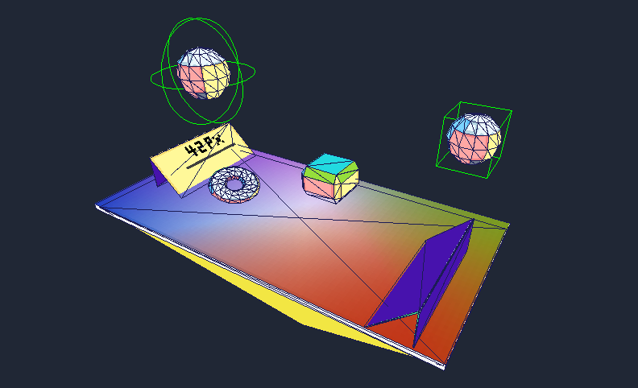

# Physics Engine From Scratch

<p align="center">
  
</p>

<p align="center">
  <strong>A lightweight 3D game engine built from scratch in C++.</strong>
  <br />
  Building a usable foundation for 3D games through custom rendering, engine architecture, and physics.
  <br /><br />
  <a href="https://github.com/S4LPICON/physics-engine-from-scratch">
    
  </a>
  <a href="https://www.libsdl.org/">
    
  </a>
  
  
  <br />
  <a href="https://github.com/S4LPICON/physics-engine-from-scratch/blob/main/ROADMAP.md">
    
  </a>
  <a href="https://github.com/S4LPICON/physics-engine-from-scratch/blob/main/LICENSE">
    
  </a>
</p>

---

## Overview

Physics Engine From Scratch is an experimental 3D game engine written in C++17. Its goal is to evolve into a **usable and extensible foundation for building small 3D games**, with control over its core systems — from rendering and scene management to physics and gameplay.

Instead of relying entirely on an existing engine, this project implements its core systems from the ground up wherever practical, while using libraries such as SDL3 for platform-level functionality.

The focus is not only on understanding how engines work internally, but on turning that understanding into a coherent engine that can be used to build actual games.

## Contents

- [Features](#features)
- [Architecture](#architecture)
- [Roadmap](#roadmap)
- [Design Philosophy](#design-philosophy)
- [Building](#building)
- [Project Status](#project-status)

---

## Features

### Rendering

- SDL3 window and frame presentation
- CPU framebuffer and software rendering
- Pixel, line, and triangle rasterization
- Triangle interpolation and texture sampling
- 3D model, view, and perspective transformations
- Depth buffering and backface culling
- Triangle clipping
- Indexed mesh representation
- OBJ model loading with vertex normals and UV coordinates

### Engine Core

- Scene management
- Game objects
- Component-based architecture
- Script components for object behavior
- Separate rendering and object update pipelines
- Camera and transform systems
- Time management and delta-time-based updates

The engine is under active development. These systems form the foundation for future rendering backends, physics simulation, and gameplay features.

## Architecture

The codebase is organized around a separation of responsibilities:

- **Engine Core** — application lifecycle and coordination.
- **Objects and Components** — scenes, game objects, and reusable behaviors.
- **Pipelines** — object updates and rendering orchestration.
- **Rendering** — graphics implementation and rendering backends.
- **Resources** — meshes, textures, and transforms.

The architecture will evolve as new features are introduced. The goal is to keep engine logic reasonably independent of rendering implementations, allowing new backends to be introduced without redesigning the entire engine.

## Roadmap

Development is focused on progressively turning the current foundation into a practical game engine.

1. **Core engine** — strengthen scene management, component behavior, resource ownership, and engine lifecycle.
2. **Rendering** — improve the software renderer and introduce an OpenGL backend.
3. **Physics** — implement rigid-body dynamics, collision detection, and collision response.
4. **Gameplay** — improve input handling, scripting, and the APIs used to build game logic.
5. **Tools and resources** — develop resource management, scene serialization, debugging, and profiling.
6. **Demonstration game** — build a small, playable 3D game using the engine.

The detailed task list and implementation progress are available in the [ROADMAP](ROADMAP.md).

## Design Philosophy

**Build systems that make games possible, not abstractions for their own sake.**

The engine is implemented from scratch wherever practical, with external libraries used when they provide useful platform-level or specialized functionality.

Design decisions should balance three goals:

- **Usability:** the engine should provide a practical way to create and run games.
- **Extensibility:** new systems and rendering backends should fit into the existing architecture.
- **Understanding:** the implementation should remain understandable and provide control over the engine's internals.

The project does not aim to replicate every feature of a large commercial engine. Its scope will grow through real development needs, experiments, and the requirements of games built on top of it.

## Building

### Requirements

- A C++17-compatible compiler
- GNU Make
- SDL3 development libraries
- `pkg-config`

### Compile and run

```bash
make
make run
```

To clean the build:

```bash
make clean
```

These commands assume the repository's Makefile is configured for the current source tree.

## Project Status

This engine is experimental and under active development. Its APIs, architecture, and feature set may change as development progresses.

The long-term objective is to build a small but usable 3D game engine, with rendering, physics, and gameplay systems that can be developed and extended together.

---

Built in C++ by [S4LPICON](https://github.com/S4LPICON).
